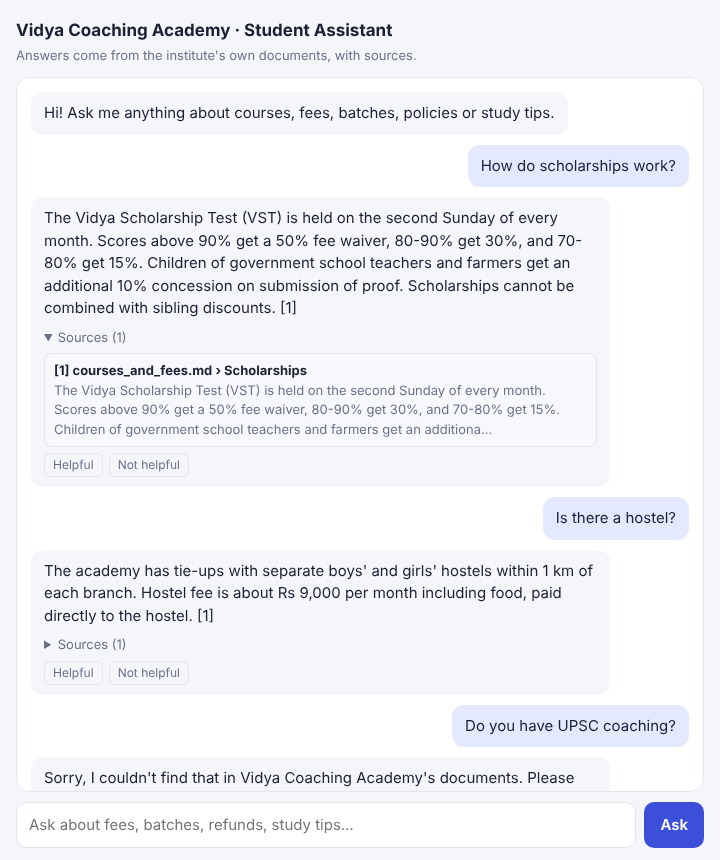
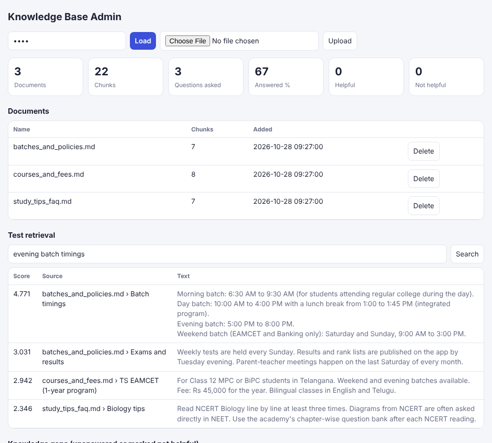

# RAG Coaching Chatbot

A **Retrieval-Augmented Generation (RAG)** assistant for coaching institutes. Staff upload their brochures, fee sheets, policies and study notes (PDF/TXT/MD). Students then ask questions and get answers **grounded in those documents, with citations**, in English or Telugu. If the answer isn't in the documents, the bot says so instead of making something up.

| Student chat | Knowledge-base admin |
|---|---|
|  |  |

## How it works

```
upload ─► extract text (pypdf) ─► heading-aware chunking (with overlap) ─► SQLite
                                                        │
question ─► follow-up rewrite / Telugu→English ─► hybrid retrieval ─► answer + [n] citations
                                                  BM25 + optional dense embeddings
                                                  fused with Reciprocal Rank Fusion
```

- **Chunking** splits on paragraphs, never crosses a section heading, and stores the heading and page number for each chunk. That's how citations can say `courses_and_fees.md › Scholarships · p.3`.
- **Retrieval** uses BM25, implemented from scratch with no search library. Optional dense embeddings (any OpenAI-compatible `/embeddings` API) are merged in with **Reciprocal Rank Fusion**.
- **Guardrails against hallucination.** An answer is given only when the best passage has a high enough BM25 score *and* covers enough of the question (idf-weighted) or matches a section heading. Otherwise the bot refuses and logs the question as a **knowledge gap** for staff.
- **Generation.** With an LLM key (Groq/OpenAI/Ollama…), the model answers *only* from the numbered context and cites `[1]`, `[2]`. Without a key, an **offline extractive mode** returns the best-matching sentences or section, so the project runs with zero API cost.
- **Conversation memory.** Follow-ups like "and can I pay it in instalments?" are rewritten into standalone questions.
- **Feedback loop.** 👍/👎 on every answer. The admin page shows questions that were unanswered or marked unhelpful, so staff know which documents to add.

## Features

- Student chat with expandable sources and feedback buttons
- Admin: upload/replace/delete documents, test retrieval for any query (scores + chunks), stats, knowledge gaps
- English + Telugu (Telugu questions are translated for search when an LLM is configured)
- Sample knowledge base for a fictional institute, "Vidya Coaching Academy", in `sample_docs/`
- 17 automated tests (chunking, BM25, answer quality, refusals, follow-ups, mocked LLM, admin API)

## Tech stack

Python · FastAPI · SQLite · NumPy · pypdf · BM25 (from scratch) · optional OpenAI-compatible LLM + embeddings · vanilla HTML/JS

## Run it

```bash
git clone https://github.com/manikantar585-lgtm/RAG-Coaching-Chatbot.git
cd RAG-Coaching-Chatbot
python -m venv .venv && source .venv/bin/activate     # Windows: .venv\Scripts\activate
pip install -r requirements.txt
cp .env.example .env          # optional: add LLM_API_KEY (Groq has a free tier)
uvicorn app.main:app --reload
```

- Student chat: http://localhost:8000
- Admin: http://localhost:8000/admin (token = `ADMIN_TOKEN` in `.env`, default `change-me`)
- API docs: http://localhost:8000/docs
- Tests: `pytest -q`

The sample documents load automatically on first start. To use your own institute's data, delete them in the admin page and upload your files.

## Configuration (`.env`)

| Variable | Default | Purpose |
|---|---|---|
| `INSTITUTE_NAME` | Vidya Coaching Academy | Shown in the UI and answers |
| `CONTACT` | the front office | Where to send students when the answer isn't known |
| `ADMIN_TOKEN` | change-me | Admin API/page password |
| `LLM_API_KEY` / `LLM_BASE_URL` / `LLM_MODEL` | empty / Groq / llama-3.1-8b-instant | Generative answers |
| `EMBED_API_KEY` / `EMBED_BASE_URL` / `EMBED_MODEL` | empty / OpenAI / text-embedding-3-small | Dense retrieval |
| `CHUNK_CHARS`, `CHUNK_OVERLAP`, `TOP_K` | 900, 150, 4 | Retrieval tuning |
| `MIN_SCORE`, `MIN_COVERAGE` | 1.0, 0.5 | When to refuse instead of answering |

## API

| Method | Path | Purpose |
|---|---|---|
| POST | `/api/ask` | `{session_id, question}` → `{answer, sources[], answered, question_id}` |
| POST | `/api/feedback` | `{question_id, helpful}` |
| GET/POST | `/api/admin/documents` | List / upload (multipart `file`) |
| DELETE | `/api/admin/documents/{id}` | Remove a document |
| GET | `/api/admin/search?q=` | Inspect retrieval results |
| GET | `/api/admin/stats`, `/api/admin/gaps` | Usage and knowledge gaps |

Admin routes need the `X-Admin-Token` header.

## Project structure

```
app/
  ingest.py     PDF/TXT/MD extraction + heading-aware chunking
  retrieval.py  tokenizer, BM25, coverage score, dense embeddings, RRF fusion
  chat.py       follow-up rewriting, guardrails, LLM + extractive answering
  store.py      SQLite: documents, chunks, question log
  main.py       FastAPI routes
static/         student chat + admin pages
sample_docs/    demo knowledge base
tests/          pytest suite
```

## Docker

```bash
docker build -t rag-coach .
docker run -p 8000:8000 -v rag-data:/data -e ADMIN_TOKEN=secret rag-coach
```

## Author

Kunduru Manikanta Reddy · [LinkedIn](https://linkedin.com/in/manikanta-reddy-9a030932a) · [GitHub](https://github.com/manikantar585-lgtm)
